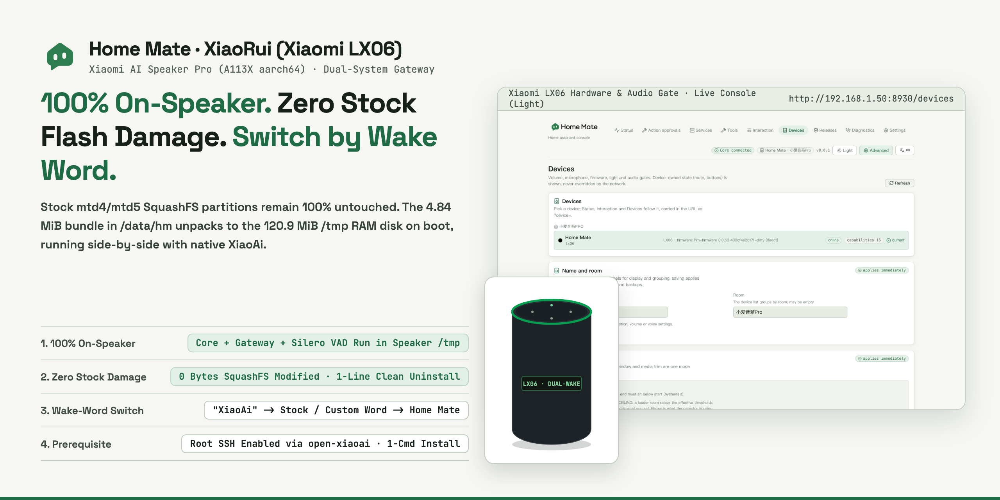
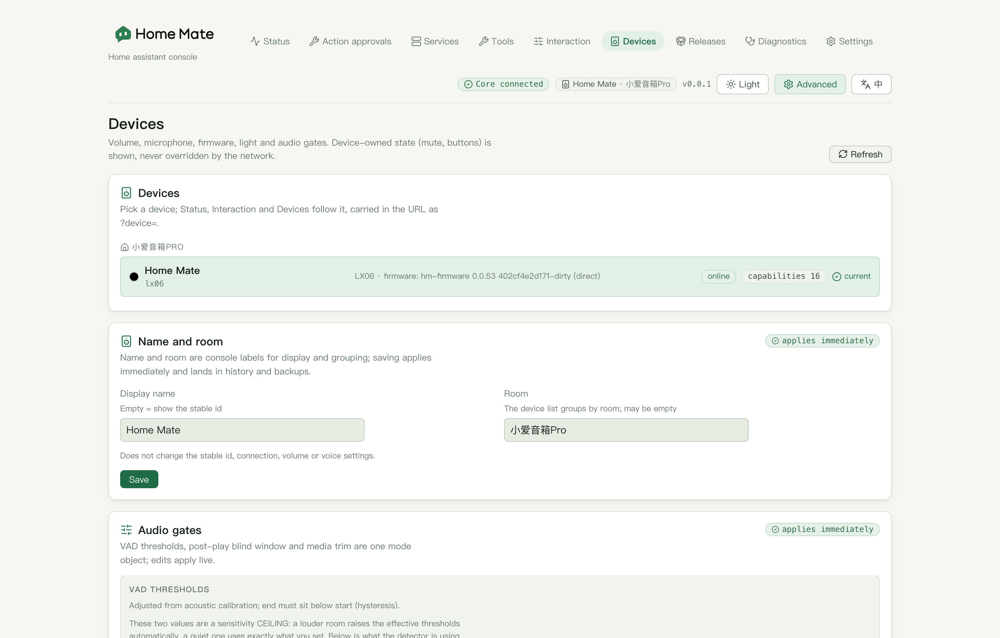
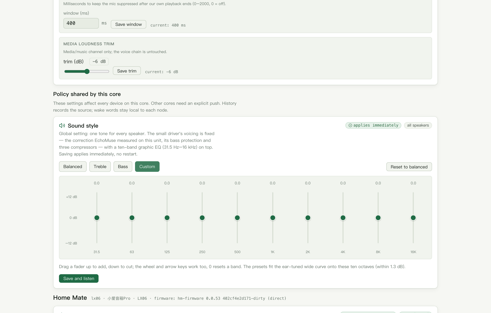
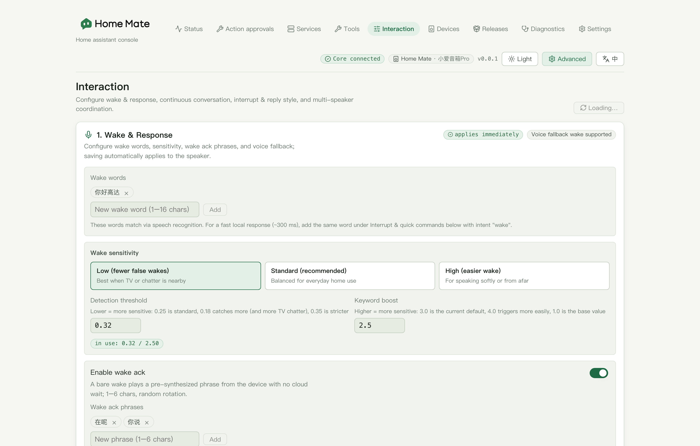
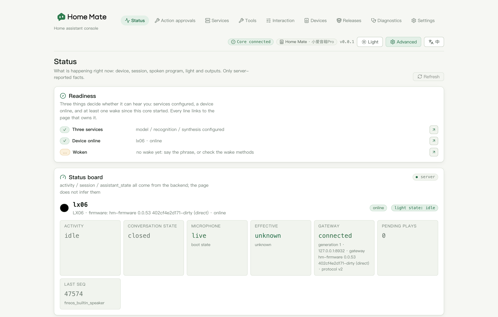

> [!IMPORTANT]
> **This repository has been consolidated and archived.**
>
> Both Amazon Echo Dot 2 (`board-dot2`) and Xiaomi AI Speaker Pro LX06 (`board-lx06`, adaptive 256 MB on-speaker & 128 MB thin gateway) now live in a single unified repository:
>
> - **New Unified Linux Gateway (`v0.0.53`)**: **[yes999zc/home-mate-gateway-linux](https://github.com/yes999zc/home-mate-gateway-linux)**
> - **Core Edge Brain (`v0.3.0`)**: **[yes999zc/home-mate](https://github.com/yes999zc/home-mate)**
> - **Android Universal APK (`v2.3.15`)**: **[yes999zc/home-mate-gateway-android](https://github.com/yes999zc/home-mate-gateway-android)**
> - **Official Website & Quickstart**: **[https://mymate.homes](https://mymate.homes)**
>
> All future updates, releases, and AI deployment prompts are maintained in `yes999zc/home-mate-gateway-linux`.

<p align="center">
  
</p>

<p align="center">
  <strong>English</strong> · <a href="README.zh-CN.md"><strong>简体中文</strong></a> · <a href="https://mymate.homes"><strong>Official Website (mymate.homes)</strong></a>
</p>

<p align="center">
  <a href="https://mymate.homes"></a>
  <a href="LICENSE"></a>
  
  
  
</p>

---

## Three Core Engineering Guarantees on Xiaomi LX06

This repository is the dedicated **Home Mate (小瑞 / XiaoRui) Device Gateway** for the **Xiaomi AI Speaker Pro (`LX06`, Amlogic A113X quad-core `aarch64`, 6-mic circular array + Hi-Fi woofer)**.

As the pure-Rust evolution of [rui (小瑞)](https://github.com/yes999zc/rui), it is engineered around three guarantees:

> [!IMPORTANT]
> **Hardware Research Disclaimer & Custom Speaker Roadmap**
> 1. **For Research & Personal Experimentation Only**: Adaptation of the **Xiaomi AI Speaker Pro (`LX06`)** in this repository is provided **strictly for edge-AI architectural research, dual-system coexistence validation, and personal non-commercial experimentation**. All trademarks belong to Xiaomi Inc. This project is not affiliated with Xiaomi and **does not sell modified third-party brand-name speakers**.
> 2. **First-Party Custom Speaker Under Active Development**: We are actively engineering a **dedicated custom Home Mate (小瑞) smart speaker hardware platform** featuring an open far-field microphone array, tuned acoustic enclosure, and native sovereign Rust firmware out of the box—requiring zero third-party unlock steps.

### 1. 100% On-Speaker Execution (No External Streaming Server)
- **Not a thin network microphone**: Unlike bridges that require an external NAS or Docker host to pull audio streams over Wi-Fi, Home Mate executes **100% inside the LX06 speaker itself**.
- **`hm-core` (`--slim`) + Vue 3 Web Console (`:8930`) + `hm-gateway` (`1.68 MiB` LTO binary) + `hm-kws` (`3.3M` Zipformer KWS + Silero VAD v4)** all run directly on the LX06's A113X ARM64 CPU inside its **`120.9 MiB /tmp` RAM tmpfs**.

### 2. Zero Stock System Damage (Dual-System Coexistence)
- **0 bytes modified on stock partitions**: Factory read-only `mtd4 (system0)` and `mtd5 (system1)` SquashFS partitions are **never touched, remounted, or reflashed** (zero flash-brick risk).
- **Storage Scheme A**: All persistent files live strictly inside `/data/hm` (`hm-bundle.tar.xz` at **`4.84 MiB`**, using 80.6% of the 6.0 MiB budget). On boot, `/data/hm/init.sh` streams decompression into `/tmp/hm`.
- **Flash wear protection**: High-frequency voice event journals (`/data/hm/state/voice-events`) are symlinked to `/tmp/hm-voice-events` in RAM and rotated at 85% tmpfs usage.
- **1-Line Factory Restore**: Run `rm -rf /data/hm /data/init.sh && reboot` over SSH to return to 100% untouched factory state.

### 3. Instant System Switching by Wake Word
- Both stock Xiaomi (`mipns-xiaomi`) and Home Mate (`hm-kws`) share the 6-microphone array concurrently through ALSA `noop` (`dsnoop`) and release ALSA `softvol` playback immediately upon idle:

| Trigger | Active System | Runtime Behavior |
| :--- | :--- | :--- |
| **Say "XiaoAi TongXue" (小爱同学)** | **Stock Xiaomi XiaoAi** (`mipns-xiaomi`) | `hm-gateway` monitors `/tmp/mico_aivs_lab/instruction.log`, yields capture, and keeps `softvol` closed so native XiaoAi responds without conflict |
| **Say Custom Wake Word (e.g. "NiHao XiaoZhi")** | **Home Mate Brain** (`hm-core`) | `hm-kws` spots wake word, pauses stock player via `ubus`, lights top LED ring, and streams 160ms pre-onset + Silero `vad_speech` to `hm-core` |
| **Say "QieHuan XiaoAi" (切换小爱) in Session** | **Instant Handoff to Stock XiaoAi** | Local Zipformer reflex intent (`retreat`) closes the Home Mate turn in <100ms without cloud round-trip |
| **Double-Tap Top `CH` Button** | **Toggle Pinned Stock XiaoAi ↔ Dual-Wake** | `lx06-switch-watch` toggles `/data/hm/mode` between `xiaoai-pinned` and `homemate` dual-wake |

---

## Live Web Console on LX06 (Light Theme Default · `http://<LX06_IP>:8930`)

<table>
  <tr>
    <td width="50%">
      
      <p align="center"><strong>LX06 Hardware &amp; Audio Gate (<code>/devices</code>)</strong><br>Online status, room assignment, and Silero VAD start/end dBFS thresholds</p>
    </td>
    <td width="50%">
      
      <p align="center"><strong>LX06 Custom 3-Band Woofer EQ (<code>/devices</code>)</strong><br>Tuned specifically for the LX06 woofer chamber (120Hz +1.5dB / 350Hz +1.0dB / 3.2kHz -1.0dB)</p>
    </td>
  </tr>
  <tr>
    <td width="50%">
      
      <p align="center"><strong>Custom Wake Word &amp; Follow-up (<code>/interaction</code>)</strong><br>Built-in Pinyin tokenizer with live <code>config_apply_v2</code> hot-reload to <code>hm-kws</code></p>
    </td>
    <td width="50%">
      
      <p align="center"><strong>LX06 Status Overview (<code>/status</code>)</strong><br>Service readiness checks, Northbound v2 link generation, and live capture state</p>
    </td>
  </tr>
</table>

<p align="center">
  
</p>

---

## Prerequisites & 10-Minute Installation Guide

### Required Prerequisites (Check Before Installing)
1. **Hardware Model**: Black cylinder **Xiaomi AI Speaker Pro** (bottom label model **`LX06`**, Amlogic A113X `aarch64`).
2. **Root SSH Unlocked via `open-xiaoai`**: You must first enable root SSH access on port 22 using the community [idootop/open-xiaoai](https://github.com/idootop/open-xiaoai) project and confirm `ssh root@<LX06_IP>` logs in.
3. **Free `/data` Space**: Run `df -k /data` over SSH and verify at least **5.5 MiB** (`5500 KB`) is available.

### Option 1: Let an AI Coding Agent Deploy It For You (Recommended)
Copy and paste this prompt into **Claude Code, Cursor, or Codex** *(remember to replace `192.168.1.50` and `192.168.1.10` with your own actual LAN IPs!)*:
```text
Please deploy Home Mate (XiaoRui) to my Xiaomi AI Speaker Pro (model LX06, root SSH already enabled via open-xiaoai):
[IMPORTANT: Replace the two example IPs below with your own actual LAN IPs]
- Speaker SSH: root@192.168.1.50        <-- Replace with your LX06 speaker's actual LAN IP
- LAN HTTP host IP: 192.168.1.10        <-- Replace with this computer's or your NAS's actual LAN IP

Steps to execute and verify (use my actual IPs above):
1. Clone https://github.com/yes999zc/home-mate.git and https://github.com/yes999zc/home-mate-gateway-lx06.git side by side.
2. SSH into root@<SPEAKER_IP> to verify `uname -m` is `aarch64` and `df -k /data` has >= 5500 KB available.
3. In home-mate-gateway-lx06, run `./tools/pack_lx06_bundle.sh` (or download prebuilt `hm-bundle.tar.xz` and `hm-kws-lx06.tar.xz` from GitHub Release v0.2.0), serve `build/lx06/` over HTTP on <HOST_IP>:18089, and verify `http://<HOST_IP>:18089/hm-kws-lx06.tar.xz` returns HTTP 200.
4. Run `./deploy/lx06/install-lx06.sh --device-ip <SPEAKER_IP> --kws-url http://<HOST_IP>:18089/hm-kws-lx06.tar.xz`.
5. Wait 15s for RAM unpack, call `POST http://<SPEAKER_IP>:8930/api/v0/auth/provision`, save the token to `~/.home-mate/lx06.token` (mode 0600), and print the console URL and token.
```

### Option 2: Manual 3-Command Installation
```bash
# 1. Pack slim hm-core + hm-gateway (aarch64 LTO) + hm-kws sidecar into build/lx06/
./tools/pack_lx06_bundle.sh

# 2. Serve the 8.53 MiB KWS model bundle over HTTP on your LAN (fetched into /tmp/hm-kws on boot)
python3 -m http.server 18089 --directory build/lx06 &

# 3. Install to /data/hm on your LX06 speaker
./deploy/lx06/install-lx06.sh \
  --device-ip 192.168.1.50 \
  --kws-url http://192.168.1.10:18089/hm-kws-lx06.tar.xz
```

---

## Acknowledgments

- [idootop/open-xiaoai](https://github.com/idootop/open-xiaoai) & [@coderzc/open-xiaoai](https://github.com/coderzc/open-xiaoai) (MIT) — Community SSH unlock prerequisite and foundational research for Xiaomi LX06.
- [k2-fsa/sherpa-onnx](https://github.com/k2-fsa/sherpa-onnx) (Apache-2.0), [Microsoft ONNX Runtime](https://github.com/microsoft/onnxruntime) (MIT), and [snakers4/silero-vad](https://github.com/snakers4/silero-vad) (MIT) — On-device Zipformer keyword spotting and Silero VAD v4 neural speech endpointing.
- [xiph/speexdsp](https://github.com/xiph/speexdsp) (BSD-3-Clause) & [pdeljanov/Symphonia](https://github.com/pdeljanov/Symphonia) (MPL-2.0) — DSP primitives and pure-Rust streaming audio decoding.
- [yes999zc/rui (小瑞)](https://github.com/yes999zc/rui) — The first-generation predecessor of Home Mate.

---

## License & Contact

- **License**: **[GNU AGPL v3.0](LICENSE)** (Northbound Protocol v2 wire contract under **[Apache-2.0](LICENSE-PROTOCOL-APACHE-2.0)**).
- **Official Website**: **[https://mymate.homes](https://mymate.homes)**
- **Contact**: **`zhangcong1985@gmail.com`** / **`yes999zc@163.com`**
