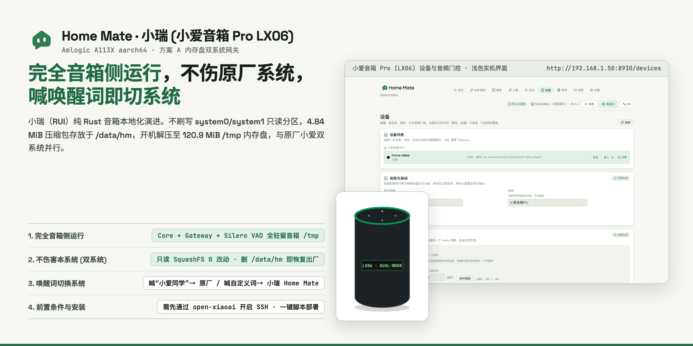
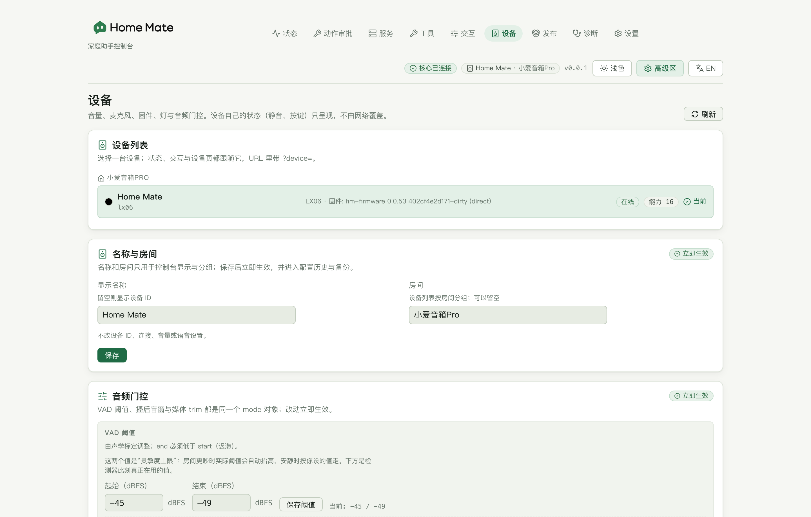
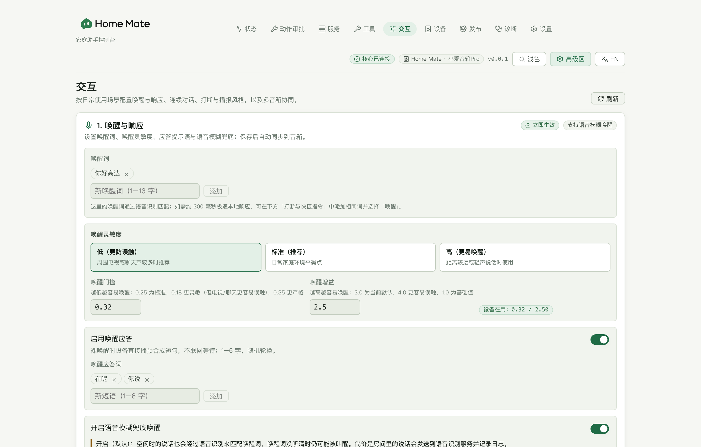
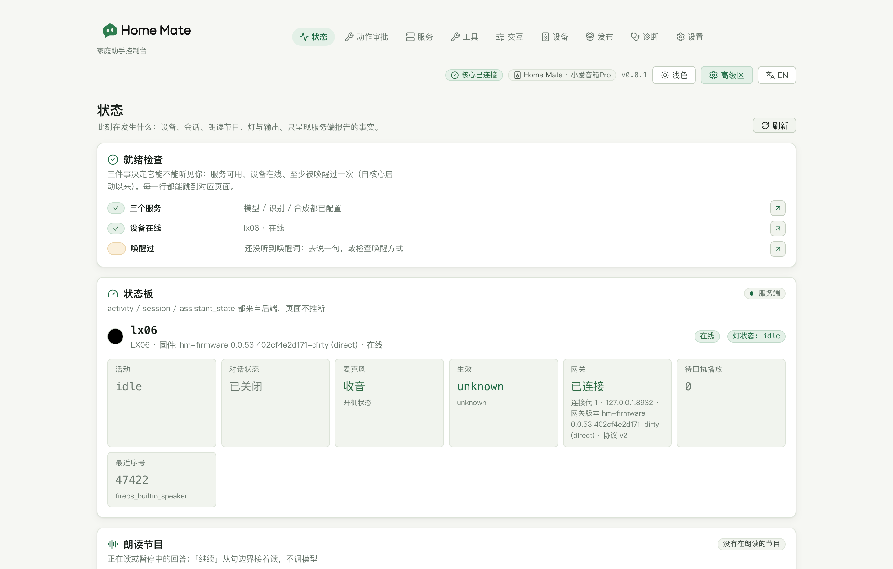

<p align="center">
  
</p>

<p align="center">
  <a href="README.md"><strong>English</strong></a> · <strong>简体中文</strong> · <a href="https://mymate.homes"><strong>官方网站 (mymate.homes)</strong></a>
</p>

<p align="center">
  <a href="https://mymate.homes"></a>
  <a href="LICENSE"></a>
  
  
  
</p>

---

## 小爱音箱 Pro (`LX06`) 三大核心设计亮点

本仓库是 **Home Mate（中文名：小瑞）** 针对**小米小爱音箱 Pro（黑色圆柱款 `LX06`，Amlogic A113X 四核 `aarch64`，6 麦环形阵列 + 独立大腔体低音炮）**打造的专属 Rust 硬件网关。作为 [小瑞 · rui](https://github.com/yes999zc/rui) 的纯 Rust 下一代演进版，它重点实现了三大核心能力：

> [!IMPORTANT]
> **硬件研究用途声明与自研定制音箱计划**
> 1. **存量音箱仅作技术研究使用**：本仓库对**小米小爱音箱 Pro（`LX06`）**的适配代码与部署脚本，**仅作为端侧纯 Rust 语音架构研究、双系统无损共存验证与个人非商业实验用途**。相关品牌与型号商标均归原厂商所有，本项目与小米公司无任何关联，**亦不售卖任何改装版第三方品牌音箱**。
> 2. **正在开发原生定制音箱**：我们正在自主研发**专为 Home Mate · 小瑞 打造的原生定制智能音箱硬件**（开放式远场多麦克风阵列、定制高保真声学腔体、出厂原生搭载主权 Rust 语音系统，无需任何第三方解锁前置步骤），敬请期待。

### 1. 完全音箱侧运行（告别外部 Docker 推流服务器）
- **无需外部电脑或 NAS 常驻推流**：不同于只把音箱当远程网络麦克风、必须依赖局域网另一台 Docker 主机拉流识别的方案，小瑞 Home Mate **100% 运行在 LX06 音箱本体内部**。
- **`hm-core`（`--slim` 核心大脑）+ Vue 3 网页管理控制台（`:8930`）+ `hm-gateway`（`1.68 MiB` LTO 网关）+ `hm-kws`（3.3M Zipformer 热词 + Silero VAD v4 神经网络断句）** 全部直接运行在小爱音箱 Pro 的四核 ARM64 处理器与 **`120.9 MiB` 的 `/tmp` 内存盘**中。

### 2. 不伤害本系统（双系统无损并行，零变砖风险）
- **原厂只读固件分区 0 字节改动**：原厂 `mtd4 (system0)` 与 `mtd5 (system1)` SquashFS 分区**保持 100% 原封不动**，没有任何刷机变砖风险。
- **存储方案 A（`/data/hm` 压缩存储 → 开机解压到 `/tmp`）**：所有持久化文件严格收敛在 `/data/hm` 目录下（主包 `hm-bundle.tar.xz` 仅 **`4.84 MiB`**，占 6.0 MiB 门限的 80.6%），开机由 `/data/hm/init.sh` 流式解压到 `/tmp/hm` 运行。
- **闪存寿命保护**：高频语音诊断日志（`/data/hm/state/voice-events`）自动软链至 `/tmp/hm-voice-events` 内存盘并在 85% 水位轮转，绝不撑满 `13.3 MiB` 的 `/data` 分区。
- **一行命令无痕恢复出厂**：随时在 SSH 执行 `rm -rf /data/hm /data/init.sh && reboot`，重启后即 100% 回到纯原厂状态。

### 3. 唤醒词切换系统（喊谁谁应，秒级切换）
- 原厂小爱（`mipns-xiaomi`）与小瑞 Home Mate（`hm-kws`）通过 ALSA `noop`（`dsnoop`）共享 6 麦阵列同时监听，并在播放空闲时立即释放 `softvol` 句柄：

| 你的语音或按键动作 | 接管应答的系统 | 音箱内部协同机制 |
| :--- | :--- | :--- |
| **喊 “小爱同学”** | **原厂小米小爱系统** (`mipns-xiaomi`) | `hm-gateway` 监控 `/tmp/mico_aivs_lab/instruction.log`，自动让出拾音并保持 `softvol` 关闭，原厂小爱无冲突应答 |
| **喊 “你好小智 / 你好高达”** *(后台可自定义)* | **小瑞 Home Mate 大脑** (`hm-core`) | `hm-kws` 命中自定义唤醒词 → 通过 `ubus` 暂停原厂播放 → 点亮顶部灯环 → 将 160ms 前导语音 + Silero `vad_speech` 送入本地 `hm-core` |
| **会话中说 “切换小爱”** | **立即本地退场交还声道给小爱** | 本地 Zipformer 反射热词（`intent: retreat`）在 100ms 内直接关闭会话，不走云端 ASR/LLM |
| **双击音箱顶部实体 `CH` 键** | **纯原厂小爱独占 ↔ 双唤醒共存** | `lx06-switch-watch` 在 `xiaoai-pinned` 与 `homemate` 双唤醒模式之间热切换 |

---

## 音箱直出后台界面（默认浅色主题 · `http://<LX06_IP>:8930`）

<table>
  <tr>
    <td width="50%">
      
      <p align="center"><strong>LX06 硬件状态与音频门控 (<code>/devices</code>)</strong><br>实时展示 LX06 在线状态、房间分组与 Silero VAD 起止分贝门限</p>
    </td>
    <td width="50%">
      
      <p align="center"><strong>LX06 专属 3 段低音防破音 EQ (<code>/devices</code>)</strong><br>针对 LX06 大腔体低音单元定制（120Hz +1.5dB / 350Hz +1.0dB / 3.2kHz -1.0dB）</p>
    </td>
  </tr>
  <tr>
    <td width="50%">
      
      <p align="center"><strong>自定义唤醒词与连续追问 (<code>/interaction</code>)</strong><br>支持任意中文唤醒词带调拼音自动编译与 <code>config_apply_v2</code> 热下发</p>
    </td>
    <td width="50%">
      
      <p align="center"><strong>LX06 状态总览 (<code>/status</code>)</strong><br>三大服务就绪自检、北向 v2 网关连接代次与麦克风实时收音状态</p>
    </td>
  </tr>
</table>

<p align="center">
  
</p>

---

## 前置条件与新手 10 分钟安装指南

### 必备前置条件（动手前请逐条核对）
1. **确认音箱硬件型号**：必须是黑色高圆柱款**小米小爱音箱 Pro（底部铭牌型号为 `LX06`，Amlogic A113X `aarch64`）**。
2. **自行完成 SSH 解锁**：请先参考开源社区项目 [idootop/open-xiaoai](https://github.com/idootop/open-xiaoai) 开启音箱的 root SSH 访问权限（端口 22），确认电脑终端可执行 `ssh root@<音箱IP>` 登录。
3. **检查 `/data` 闪存可用空间**：SSH 登录后执行 `df -k /data`，确认可用空间 ≥ **`5.5 MiB`**（`5500 KB`）。

### 方式一：让 AI 编程助手（Claude Code / Cursor / Codex）代你一键部署（推荐）
直接把下面这段话复制给你的 AI 助手（**注意：复制后请把话术里的示例 IP `192.168.1.50` 和 `192.168.1.10` 替换为你自己的真实局域网 IP**）：
```text
请帮我将 Home Mate · 小瑞部署到我的小米小爱音箱 Pro（型号 LX06，已通过 open-xiaoai 开启 root SSH）：
【请先将下方两个示例 IP 替换为你自己的真实局域网 IP】
- 音箱 SSH 地址：root@192.168.1.50  <-- 替换为你小爱音箱 Pro 的实际局域网 IP（密码：open-xiaoai 或已配好免密）
- 局域网托管机 IP：192.168.1.10    <-- 替换为你当前电脑或常开 NAS 的实际局域网 IP

请按以下步骤依次执行并在每一步向我汇报事实结果（执行时请统一使用我上面提供的真实 IP）：
1. 克隆 https://github.com/yes999zc/home-mate.git 与 https://github.com/yes999zc/home-mate-gateway-lx06.git 到平级目录。
2. SSH 登录 root@<音箱IP> 检查 `uname -m`（确认为 aarch64）与 `df -k /data /tmp`（确认 /data 可用空间 >= 5500 KB；若不足请先帮我清理 /data/log/* 旧日志）。
3. 在 home-mate-gateway-lx06 目录执行 `./tools/pack_lx06_bundle.sh`（或直接从 GitHub Release v0.1.0 下载预编译好的 hm-bundle.tar.xz 与 hm-kws-lx06.tar.xz），并用后台 HTTP 服务在 <托管机IP>:18089 托管 build/lx06/ 目录（验证 curl -I http://<托管机IP>:18089/hm-kws-lx06.tar.xz 返回 200）。
4. 执行 `./deploy/lx06/install-lx06.sh --device-ip <音箱IP> --kws-url http://<托管机IP>:18089/hm-kws-lx06.tar.xz` 完成方案 A 免刷机安装（绝不修改 mtd4/mtd5 原厂只读分区）。
5. 等待 15 秒内存盘解压完成后，调用 `POST http://<音箱IP>:8930/api/v0/auth/provision` 生成家庭访问令牌并保存到本机 `~/.home-mate/lx06.token`（权限 0600），最后打印控制台地址与令牌供我登录。
```

### 方式二：手工三步命令安装
```bash
# 1. 编译打包 --slim hm-core + hm-gateway (aarch64 LTO) + hm-kws 到 build/lx06/
./tools/pack_lx06_bundle.sh

# 2. 在局域网常开机器或本机通过 HTTP 托管 8.53 MiB 离线 KWS 模型包（音箱开机拉取到 /tmp/hm-kws）
python3 -m http.server 18089 --directory build/lx06 &

# 3. 执行一键安装脚本写入音箱 /data/hm 并拉起双系统守护进程
./deploy/lx06/install-lx06.sh \
  --device-ip 192.168.1.50 \
  --kws-url http://192.168.1.10:18089/hm-kws-lx06.tar.xz
```

---

## 致谢

- [idootop/open-xiaoai](https://github.com/idootop/open-xiaoai) 与 [@coderzc/open-xiaoai](https://github.com/coderzc/open-xiaoai)（MIT）—— 小米小爱音箱 Pro（`LX06`）的 SSH 开启前置方案与早期探索基石。
- [k2-fsa/sherpa-onnx](https://github.com/k2-fsa/sherpa-onnx)（Apache-2.0）、[Microsoft ONNX Runtime](https://github.com/microsoft/onnxruntime)（MIT）与 [snakers4/silero-vad](https://github.com/snakers4/silero-vad)（MIT）—— 端侧 3.3M Zipformer 热词检测与 Silero VAD v4 神经网络端点检测。
- [xiph/speexdsp](https://github.com/xiph/speexdsp)（BSD-3-Clause）与 [pdeljanov/Symphonia](https://github.com/pdeljanov/Symphonia)（MPL-2.0）—— 声学处理原语与纯 Rust 流式音频解码。
- [yes999zc/rui（小瑞）](https://github.com/yes999zc/rui) —— Home Mate 的第一代前身项目。

---

## 开源协议与联系方式

- **开源协议**：**[GNU AGPL v3.0](LICENSE)**（北向 Protocol v2 通信协议规范遵循 **[Apache-2.0](LICENSE-PROTOCOL-APACHE-2.0)**）。
- **官方网站**：**[https://mymate.homes](https://mymate.homes)**
- **联系作者**：**`zhangcong1985@gmail.com`** / **`yes999zc@163.com`**
